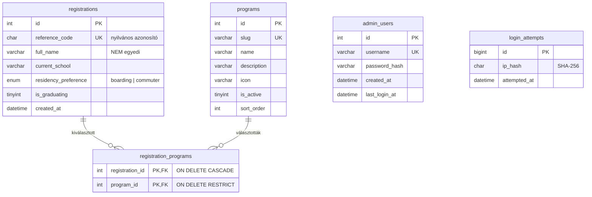

# Nyílt nap kezelő

Regisztrációs felület egy iskola nyílt napjára, **sima PHP-ban** (keretrendszer nélkül). A diákok egy táblagépre optimalizált űrlapon jelentkeznek; az iskola munkatársai egy védett adminfelületen látják a jelentkezéseket, a szakmánkénti és kollégiumi statisztikákat, és szükség esetén törölhetnek.

> Az iskola neve, logója, színei és a szakmák **helyettesítő (példa) adatok** — lásd [Arculat](#arculat-testreszabása) és [Szakmák](#szakmák-beállítása).

| Nyilvános űrlap (asztali) | Adminisztráció – áttekintés |
|---|---|
|  |  |

| Statisztikák | Jelentkezések (táblagép) | Sikeres regisztráció (mobil) |
|---|---|---|
|  |  |  |

A képernyőképeken kizárólag **kitalált demó adatok** szerepelnek.

---

## Tartalom

- [Funkciók](#funkciók)
- [Oldalak és útvonalak](#oldalak-és-útvonalak)
- [Követelmények](#követelmények)
- [Gyors indítás (helyi gépen)](#gyors-indítás-helyi-gépen)
- [Környezeti változók](#környezeti-változók)
- [Adatbázis](#adatbázis)
- [Szakmák beállítása](#szakmák-beállítása)
- [Arculat testreszabása](#arculat-testreszabása)
- [Statisztikák – definíciók](#statisztikák--definíciók)
- [Biztonság](#biztonság)
- [Adatvédelem](#adatvédelem)
- [Tesztelés](#tesztelés)
- [Éles telepítés](#éles-telepítés)
- [Hibaelhárítás](#hibaelhárítás)
- [Feltöltés GitHubra](#feltöltés-githubra)
- [Projektstruktúra](#projektstruktúra)
- [Licenc](#licenc)

---

## Funkciók

**Nyilvános regisztráció**
- Táblagépre tervezett, reszponzív űrlap (álló/fekvő táblagép, mobil, asztali gép).
- Mezők: teljes név, jelenlegi iskola, egy vagy több érdeklődési terület (szakma), kollégista/bejárós, végzős igen/nem.
- Szerveroldali ellenőrzés magyar, mezőszintű hibaüzenetekkel és hibaösszesítővel; a helyes adatok megmaradnak.
- JavaScript nélkül is teljesen működik; JS-sel azonnali visszajelzést, kijelölésszámlálót és dupla beküldés elleni védelmet ad.
- Post/Redirect/Get: a sikeres oldal frissítése nem küldi újra az űrlapot; az ugyanazon űrlap kétszeri beküldése sem hoz létre két sort.
- Azonos nevű diákok (akár teljesen azonos adatokkal is) külön-külön jelentkezhetnek.
- Sikeres regisztrációnál rövid, nem sorszám jellegű azonosító (pl. `N6D9-QPYJ`) és összefoglaló.

**Adminisztráció**
- Bejelentkezés jelszó-hash-sel, munkamenet-védelemmel és brute-force korlátozással.
- Áttekintés: összes jelentkező, végzősök, kollégisták, képviselt szakmák; szakmánkénti diagram; kollégista × végzős kereszttábla; legutóbbi jelentkezések.
- Jelentkezések listája: keresés név és iskola alapján, szűrés szakmára, végzős státuszra és kollégiumi igényre (kombinálhatók), rendezés, lapozás (25/50/100), aktív szűrő-címkék.
- Törlés megerősítő párbeszédablakkal (JS nélkül megerősítő oldallal), csak POST + CSRF tokennel.
- Statisztikák: összesítők, kollégista × végzős bontás, részletes szakmánkénti táblázat, napi bontás, nyomtatható nézet.
- CSV export a szűrt listáról (Excel-barát, képlet-injekció ellen védve).

## Oldalak és útvonalak

| Útvonal | Metódus | Leírás | Védelem |
|---|---|---|---|
| `/` | GET | Regisztrációs űrlap | – |
| `/` | POST | Jelentkezés beküldése | CSRF |
| `/sikeres` | GET | Sikeres regisztráció (PRG) | csak a beküldő munkamenete |
| `/admin/login` | GET, POST | Bejelentkezés | CSRF, korlátozás |
| `/admin/logout` | POST | Kijelentkezés | admin + CSRF |
| `/admin` (`/admin/dashboard`) | GET | Áttekintés | admin |
| `/admin/registrations` | GET | Lista, keresés, szűrés, lapozás | admin |
| `/admin/registrations/export` | GET | CSV export (a szűrt lista) | admin |
| `/admin/registrations/{id}/delete` | GET | Törlés megerősítése (nem töröl) | admin |
| `/admin/registrations/{id}/delete` | POST | Törlés | admin + CSRF |
| `/admin/statistics` | GET | Statisztikák | admin |

Minden kérés a `public/index.php` front controlleren megy át. Az alkalmazás alkönyvtárban is működik (pl. `http://localhost/nyiltnap-kezelo/public/`), a linkek automatikusan alkalmazkodnak.

## Követelmények

- **PHP 8.1+** (fejlesztve PHP 8.2-n) a `pdo_mysql` és `mbstring` kiterjesztéssel; az `intl` opcionális (Unicode-normalizálás).
- **MariaDB 10.3+** vagy **MySQL 5.7+ / 8.x** (fejlesztve és tesztelve: MariaDB 10.4, XAMPP).
- Webszerver: Apache `mod_rewrite`-tal, Nginx, vagy fejlesztéshez a PHP beépített szervere.
- Composer, Node.js és npm **nem kell**. A betűtípusok a projekttel együtt szállítódnak (nincs külső CDN).

## Gyors indítás (helyi gépen)

```bash
# 1. Forrás
git clone https://github.com/<felhasznalo>/nyiltnap-kezelo.git
cd nyiltnap-kezelo

# 2. Beállítások: másold le a mintát, és írd be az adatbázis adatait
cp .env.example .env          # Windows: copy .env.example .env
#   XAMPP-nál általában: DB_USER=root, DB_PASS= (üres), APP_ENV=development

# 3. Adatbázis + táblák + példa szakmák (többször is futtatható)
php scripts/install.php

# 4. Első admin fiók (a jelszót rejtve kéri be, és csak hash-ként tárolja)
php scripts/create_admin.php

# 5. Fejlesztői szerver
php -S localhost:8000 -t public public/index.php
```

Ezután:
- nyilvános űrlap: <http://localhost:8000/>
- admin: <http://localhost:8000/admin/login>

**Demó adatok (csak fejlesztéshez/bemutatóhoz):**

```bash
php scripts/seed_demo.php --yes            # 48 kitalált jelentkező
php scripts/seed_demo.php --yes --count=120
```

A parancs `APP_ENV=production` mellett nem fut le, és kizárólag kitalált neveket és „Minta/Példa” iskolaneveket használ.

**XAMPP / Apache alatt:** ha a projektmappa a `htdocs`-ban van, a `http://localhost/nyiltnap-kezelo/public/` cím működik (kell hozzá a `mod_rewrite` és az `AllowOverride All`). Ilyenkor a `http://localhost/nyiltnap-kezelo/` is használható, mert a gyökérben lévő `.htaccess` minden kérést a `public/` mappába irányít, a privát mappákat pedig tiltja.

**Admin fiók parancssorból, nem interaktívan** (pl. szkriptből):

```bash
php scripts/create_admin.php admin --password-stdin < jelszo.txt
php scripts/create_admin.php admin --update        # meglévő fiók jelszócseréje
```

## Környezeti változók

A beállítások a `.env` fájlból vagy valódi környezeti változókból jönnek; a környezeti változó az erősebb. A `.env` **soha** nem kerül a repóba (`.gitignore`).

| Változó | Alapértelmezés | Leírás |
|---|---|---|
| `APP_ENV` | `production` | `production` / `development` / `testing` |
| `APP_DEBUG` | `false` | `true` esetén a hibaoldal fejlesztői részleteket mutat. **Élesben mindig `false`.** |
| `APP_TIMEZONE` | `Europe/Budapest` | Időzóna (megjelenítés, napi statisztika) |
| `DB_HOST`, `DB_PORT` | `127.0.0.1`, `3306` | Adatbázis-szerver |
| `DB_NAME` | `nyiltnap_kezelo` | Adatbázis neve |
| `DB_USER`, `DB_PASS` | – | Hozzáférés |
| `DB_SOCKET` | üres | Unix socket (ha a tárhely így kéri) |
| `TEST_DB_NAME` | `<DB_NAME>_test` | A tesztek adatbázisa; kötelezően `_test` végű |
| `SESSION_SECURE` | `auto` | Secure süti: `auto` = HTTPS esetén igen |
| `TRUST_PROXY` | `false` | `true`, ha megbízható reverse proxy mögött fut (X-Forwarded-* fejlécek) |

## Adatbázis

Normalizált séma (`database/schema.sql`), InnoDB, `utf8mb4_unicode_ci`:



- A `full_name` szándékosan **nem egyedi**; az elsődleges kulcs egész szám.
- Jelentkezés törlésekor a kapcsolósorok automatikusan törlődnek (`CASCADE`), a szakmák megmaradnak. Szakmát nem lehet törölni, amíg jelentkezés hivatkozik rá (`RESTRICT`); helyette inaktiválni kell.
- Indexek: `created_at`, `is_graduating`, `(residency_preference, is_graduating)`, `full_name`, valamint a kapcsolótábla mindkét iránya.
- A jelentkezés és a szakmakapcsolatai **egy tranzakcióban** íródnak: ha bármelyik sor hibás, semmi sem mentődik.
- A `created_at` az alkalmazás időzónájában (`APP_TIMEZONE`) tárolódik. A kapcsolat a munkamenet időzónáját is erre állítja, így a napi bontás helyi naptári napok szerint készül.
- A kapcsolat szigorú SQL-módot használ (`STRICT_TRANS_TABLES`), így a túl hosszú adat hibát ad, és nem csonkolódik csendben.

Kézi import (a `scripts/install.php` helyett):

```bash
mysql -u USER -p --default-character-set=utf8mb4 -e "CREATE DATABASE nyiltnap_kezelo CHARACTER SET utf8mb4 COLLATE utf8mb4_unicode_ci"
mysql -u USER -p --default-character-set=utf8mb4 nyiltnap_kezelo < database/schema.sql
mysql -u USER -p --default-character-set=utf8mb4 nyiltnap_kezelo < database/seed.sql
```

phpMyAdminban: hozd létre az adatbázist `utf8mb4_unicode_ci` illesztéssel, majd importáld a két fájlt ebben a sorrendben.

## Szakmák beállítása

A választható szakmák **egyetlen helyen** vannak: a `programs` táblában. Az űrlap, a szűrők és a statisztikák is innen dolgoznak. A `database/seed.sql` hat semleges példát tölt be (Informatika és szoftverfejlesztés, Gépészet, Elektronika és elektrotechnika, Mechatronika és robotika, Kreatív digitális tervezés, Épületgépészet és energetika).

**Telepítés előtt:** írd át a `database/seed.sql` fájlt az iskola valódi szakmáira.
**Telepítés után** SQL-lel (phpMyAdmin vagy `mysql`):

```sql
-- Új szakma
INSERT INTO programs (slug, name, description, icon, sort_order)
VALUES ('szakacs', 'Szakács', 'Konyhatechnológia, vendéglátás', 'users', 70);

-- Átnevezés / leírás módosítása
UPDATE programs SET name = 'Gépgyártás-technológia', description = 'CNC, gyártástervezés'
WHERE slug = 'gepeszet';

-- Kivezetés: eltűnik az űrlapról, a régi jelentkezések és statisztikák megmaradnak
UPDATE programs SET is_active = 0 WHERE slug = 'energetika';

-- Sorrend az űrlapon
UPDATE programs SET sort_order = 5 WHERE slug = 'informatika';
```

Elérhető ikonnevek (`icon` oszlop): `code`, `gear`, `chip`, `robot`, `pen`, `bolt`, `layers`, `school`, `users`. Ismeretlen név esetén a `layers` ikon jelenik meg.

## Arculat testreszabása

| Mit | Hol |
|---|---|
| Iskola neve, nyílt nap neve, éve, dátuma, időpontja, helyszíne | `app/Config/config.php` → `brand` |
| Adatkezelési tájékoztató szövege | `app/Config/config.php` → `brand.privacy_paragraphs` |
| Színek | `public/assets/css/tokens.css` → `--brand-*` változók |
| Logó (fejléc, admin, lábléc) | `app/Views/partials/mark.php` (inline SVG) |
| Favicon / önálló jelkép | `public/favicon.svg`, `public/assets/img/school-mark.svg` |
| Főcím és bevezető szöveg | `app/Views/public/hero.php` |
| Betűtípusok | `public/assets/fonts/` + `tokens.css` (`--font-*`) |

A mellékelt jelkép (nyitott boltíves kapu felkelő nappal) **eredeti, helyettesítő grafika**, nem hivatalos logó. Az iskola saját logójával cseréld le: a `mark.php` tartalmát cseréld az iskola SVG-jére, vagy egy `` elemre, amely a `public/assets/img/` mappából tölt be. Ha egy eseményadat (pl. helyszín) üres, az az elem nem jelenik meg.

## Statisztikák – definíciók

- **Összes jelentkező:** a `registrations` sorainak száma. Egy jelentkező egyszer számít, akárhány szakmát jelölt meg (nincs JOIN, nincs „felfújás”).
- **Szakmánkénti számok:** egy jelentkező minden általa megjelölt szakmánál egyszer számít. Ezért a szakmánkénti számok összege nagyobb lehet a jelentkezők számánál; ezt a felület is jelzi. A kapcsolótábla kompozit kulcsa garantálja, hogy egy szakmán belül nincs dupla számolás.
- **Szakmánként:** jelentkezők, végzősök, nem végzősök, kollégisták, kollégista + végzős, kollégista + nem végzős, bejárósok.
- **Kollégiumi igény:** kollégista/bejárós × végzős/nem végzős kereszttábla összesen (Áttekintés és Statisztikák oldal).
- **Napi bontás:** jelentkezések naptári naponként (legfeljebb az utolsó 30 nap, amelyen volt jelentkezés).

Minden szám az `app/Models/Statistics.php` lekérdezéseiből jön; az áttekintés és a statisztikai oldal ugyanazt a kódot használja.

## Biztonság

- **SQL injection:** minden lekérdezés PDO prepared statementtel fut (`ATTR_EMULATE_PREPARES = false`). A rendezés csak fehérlistás kulcsot fogad, a keresésben a `%` és a `_` szó szerint értendő.
- **XSS:** minden kimenet egy központi `e()` függvényen megy át (`htmlspecialchars`, `ENT_QUOTES | ENT_SUBSTITUTE`). A szigorú CSP-ben nincs `unsafe-inline`, mert nincs inline script vagy style.
- **CSRF:** munkamenetenkénti token (`hash_equals`) minden állapotváltoztató POST-on: regisztráció, bejelentkezés, kijelentkezés, törlés.
- **Munkamenet:** `HttpOnly`, `SameSite=Lax`, HTTPS-en `Secure` és `__Host-` előtag, strict mode, új munkamenet-azonosító belépéskor, 2 óra inaktivitás után kiléptetés. Az admin fiók létezését minden kérésnél ellenőrzi.
- **Jelszavak:** `password_hash()` / `password_verify()`, automatikus újrahash-elés. Nincs alapértelmezett jelszó; az első fiókot a `scripts/create_admin.php` hozza létre.
- **Brute-force:** IP-címenként 15 percen belül 5 sikertelen próbálkozás után ideiglenes várakozás (429 + `Retry-After`), soha nem végleges zárolás. Az IP-cím csak hash-ként tárolódik. *Korlát:* IP-címet váltogató támadót ez nem állít meg; a fő védelem az erős jelszó.
- **Felhasználó-felsorolás ellen:** általános hibaüzenet, és nem létező felhasználónál is lefut a jelszó-ellenőrzés.
- **Törlés:** csak POST + CSRF + bejelentkezés. A megerősítő űrlap az azonosítót is elküldi, ezért egy elavult vagy manipulált űrlap nem törölhet másik jelentkezőt. A GET soha nem töröl.
- **Open redirect ellen:** a belépés utáni és a törlés utáni visszatérési cím csak `/admin…` útvonal lehet.
- **Fejlécek:** `Content-Security-Policy`, `X-Frame-Options: DENY`, `X-Content-Type-Options`, `Referrer-Policy`, `Permissions-Policy`, HTTPS-en HSTS. Minden oldal `Cache-Control: no-store`; az admin `noindex`.
- **Hibakezelés:** a felhasználó csak általános magyar hibaoldalt lát. A részletek a `storage/logs/app.log`-ba kerülnek, űrlapadatok, jelszavak és munkamenet-azonosítók nélkül.
- **Fájlok:** csak a `public/` mappa nyilvános. A többi mappát `.htaccess` is tiltja arra az esetre, ha a tárhely a teljes projektet szolgálná ki.

## Adatvédelem

- Csak a feladatban előírt adatokat gyűjti: név, jelenlegi iskola, szakmák, kollégium, végzős státusz. Nincs e-mail, telefonszám, születési dátum vagy hozzájárulás-checkbox.
- A lábléc adatkezelési tájékoztatója **sablon**: az iskolának át kell néznie és jóvá kell hagynia (`app/Config/config.php`). A projekt nem állítja, hogy jogi megfelelőséget tanúsítana.
- **Javaslat:** az iskola határozzon meg megőrzési időt, és a nyílt nap után törölje az adatokat:

  ```sql
  -- minden jelentkezés törlése (a szakmakapcsolatok automatikusan törlődnek)
  DELETE FROM registrations;
  -- vagy csak egy dátum előttiek
  DELETE FROM registrations WHERE created_at < '2026-12-31';
  ```
- Közös (kioszk) táblagépen az új űrlap betöltésekor az előző jelentkező összefoglalója törlődik a munkamenetből. A böngésző automatikus kitöltése miatt érdemes vendég- vagy inkognitóprofilt használni.

## Tesztelés

```bash
php tests/run.php              # szintaxis + egység + végponttól végpontig (kb. 15 mp)
php tests/run.php --skip-lint  # a php -l lépés nélkül
```

A tesztek egy **külön, eldobható adatbázist** használnak (`TEST_DB_NAME`, kötelezően `_test` végű, és nem egyezhet a `DB_NAME`-mel). Ennek a tábláit minden futás újraépíti; a valódi adatbázishoz a tesztek nem nyúlnak. A HTTP-tesztek egy valódi `php -S` szervert indítanak a tesztadatbázissal.

Lefedett területek (66 ellenőrzés), többek között:
- `php -l` minden PHP fájlon; séma-import (idempotens, InnoDB, utf8mb4); a név nem egyedi;
- érvényes és érvénytelen bemenetek (üres, csak szóköz, túl hosszú, hibás UTF-8, vezérlőkarakter, hamis, inaktív, ismétlődő és nem létező szakma-id, érvénytelen választások);
- mentés több szakmával, azonos nevek, **tranzakció visszagörgetése** hibás kapcsolósornál;
- statisztika ismert adathalmazon: összesítők, szakmánkénti és végzős-bontás, kollégista × végzős, nincs „felfújás”;
- kombinált szűrők, lapozás, `%`/`_`/aposztróf a keresésben, SQL injection kísérletek, fehérlistás rendezés;
- CSRF, PRG, dupla beküldés, XSS escapelés, admin-útvonalak védelme, GET-tel nem törlés, elavult törlés, open redirect, munkamenet-regenerálás, 429-es korlátozás, 404/405, 503 elérhetetlen adatbázisnál, CSV-képletinjekció.

A kézi ellenőrzőlista (billentyűzet, képernyőméretek, JS nélkül) a [`tests/README.md`](tests/README.md) fájlban van.

## Éles telepítés

> **A GitHub Pages nem futtat PHP-t**, ezért erre a projektre nem alkalmas. PHP + MySQL tárhely kell: iskolai szerver, cPanel-es vagy más megosztott tárhely, vagy VPS.

1. **Fájlok feltöltése** (`git clone` vagy FTP). A **document root a `public/` mappa** legyen. Ha ez nem állítható, töltsd fel a teljes projektet: a gyökérben lévő `.htaccess` a `public/` mappába irányít, és tiltja a privát mappákat (ehhez `mod_rewrite` és `AllowOverride All` kell).
2. **Adatbázis és felhasználó:** külön felhasználó, csak erre az adatbázisra szóló jogokkal (`SELECT, INSERT, UPDATE, DELETE`, a telepítéshez `CREATE, ALTER, INDEX, REFERENCES`). Karakterkészlet: `utf8mb4_unicode_ci`.
3. **Beállítások:** `.env` a projekt gyökerébe (nem a `public/`-ba), vagy környezeti változók a tárhely paneljén:
   `APP_ENV=production`, `APP_DEBUG=false`, `DB_*`.
4. **Séma:** SSH-n `php scripts/install.php`, vagy phpMyAdminban a `schema.sql` és a `seed.sql` importja.
5. **Admin fiók:** SSH-n `php scripts/create_admin.php`. SSH nélkül készíts hash-t a saját gépeden (a jelszót a standard bemenetre írod, így nem kerül a parancsnaplóba), majd szúrd be phpMyAdminban:
   ```bash
   php -r "echo password_hash(trim(fgets(STDIN)), PASSWORD_DEFAULT), PHP_EOL;"
   ```
   ```sql
   INSERT INTO admin_users (username, password_hash) VALUES ('admin', '<a fenti hash>');
   ```
6. **HTTPS** bekapcsolása (pl. Let's Encrypt). A `SESSION_SECURE=auto` ekkor magától Secure sütit használ. Proxy mögött: `TRUST_PROXY=true`.
7. A **`storage/logs/`** legyen írható a webszerver számára.
8. **Ellenőrzés:** a `/.env`, `/app/…`, `/database/…` címek ne legyenek elérhetők (403/404). Próbáld ki a belépést, egy tesztjelentkezést és annak törlését.
9. A `scripts/seed_demo.php` élesben **nem** fut, és nem is szabad futtatni.

**Nginx** példakonfiguráció:

```nginx
server {
    server_name nyiltnap.example.hu;
    root /var/www/nyiltnap-kezelo/public;
    index index.php;

    location / { try_files $uri /index.php$is_args$args; }
    location ~ \.php$ {
        include fastcgi_params;
        fastcgi_param SCRIPT_FILENAME $document_root/index.php;
        fastcgi_pass unix:/run/php/php8.2-fpm.sock;
    }
    location ~ /\. { deny all; }
}
```

## Hibaelhárítás

| Tünet | Megoldás |
|---|---|
| „Átmenetileg nem elérhető” (503) | Az adatbázis nem érhető el, vagy hibásak a `.env` adatai. Nézd meg a `storage/logs/app.log`-ot. |
| A főoldal működik, de az `/admin` 404 Apache alatt | Nincs `mod_rewrite`, vagy `AllowOverride None` van beállítva. |
| Hiányzik a stílus alkönyvtárban | Nyisd meg a `/public/` végű címet, vagy állítsd a document rootot a `public/` mappára. |
| „A biztonsági ellenőrzés lejárt” | Lejárt a munkamenet, vagy a böngésző tiltja a sütiket. Töltsd újra az oldalt. |
| „Túl sok sikertelen bejelentkezési kísérlet” | Várj 15 percet, vagy töröld a korlátozást: `DELETE FROM login_attempts;` |
| Ékezetek hibásan jelennek meg | Az adatbázis és az import is `utf8mb4` legyen (`--default-character-set=utf8mb4`). |
| XAMPP: `Module "openssl" is already loaded` | Az XAMPP `php.ini` kétszer tölti be az openssl-t. Ártalmatlan; a duplikált `extension=openssl` sor törölhető. |
| Elfelejtett admin jelszó | `php scripts/create_admin.php <felhasználónév> --update` |

## Feltöltés GitHubra

Ellenőrizd, hogy a `.env` és a `storage/logs/*.log` **nem** szerepel a feltöltendők között (a `.gitignore` kizárja őket).

```bash
git init -b main
git add .
git status                      # a .env NEM lehet a listában
git commit -m "Nyílt nap kezelő – első verzió"

# GitHub CLI-vel (alapból privát repó):
gh repo create nyiltnap-kezelo --private --source=. --push

# vagy kézzel létrehozott üres repóba:
git remote add origin https://github.com/<felhasznalo>/nyiltnap-kezelo.git
git push -u origin main
```

A repó nem tartalmaz jelentkezői adatot, jelszót vagy adatbázis-mentést, ezért iskolai beadandóként nyilvános is lehet. Ha bizonytalan vagy, maradj a privátnál.

## Projektstruktúra

```text
public/                 ← document root (egyedül ez nyilvános)
  index.php             front controller
  .htaccess             átírás az index.php-ra, dotfájlok tiltása
  assets/css/           tokens.css, base.css, public.css, admin.css
  assets/js/            public.js, admin.js (progresszív javítás)
  assets/fonts/         Inter, Instrument Serif, JetBrains Mono (OFL)
  assets/img/           school-mark.svg
app/
  bootstrap.php         autoloader, .env, konfiguráció, hibakezelés
  Config/               config.php (arculat is), routes.php
  Core/                 Router, Request, Response, Session, Csrf, Auth, View, Validator, Database, ErrorHandler
  Controllers/          RegistrationController, Admin/*Controller
  Forms/                RegistrationForm (szerveroldali ellenőrzés)
  Models/               Registration, Program, Statistics, AdminUser, LoginThrottle
  Support/              helpers.php, RegistrationFilters, SubmissionGuard, SqlFile
  Views/                layouts/, public/, admin/, partials/, errors/
database/               schema.sql, seed.sql
scripts/                install.php, create_admin.php, seed_demo.php
storage/logs/           naplók (nem kerül a repóba)
tests/                  run.php, harness.php, README.md
docs/screenshots/       képernyőképek a README-hez
.htaccess               tartalék, ha a projekt gyökere a webroot
```

## Licenc

A kód [MIT licencű](LICENSE). Iskolai feladatként készült, szabadon továbbfejleszthető. A mellékelt betűtípusok (Inter, Instrument Serif, JetBrains Mono) a SIL Open Font License 1.1 alatt állnak; a licencszövegek a `public/assets/fonts/` mappában vannak.
